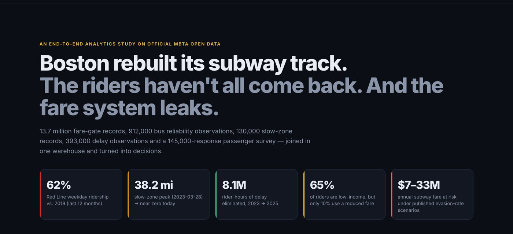
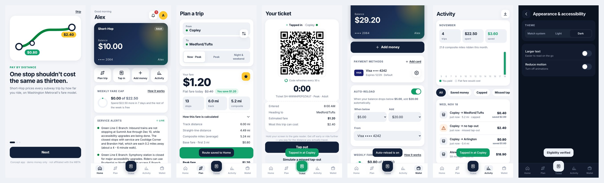

# MBTA Transit Intelligence

**An end-to-end analytics platform on Boston's public transit system, built entirely from official MBTA open data, plus an evidence-based playbook for fare evasion and the other problems riders face.**


**Live dashboard → https://deekshithkomira.github.io/mbta-transit-intelligence/**



The pipeline joins 13.7M fare-gate records, 912K bus reliability observations, 130K slow-zone records, 393K rider-delay observations and a 145K-response passenger survey into one DuckDB warehouse. The warehouse feeds forecasting, Bayesian, survival, econometric and optimisation models, and the results publish to a static dashboard that GitHub Actions rebuilds every week.

---

## Headline findings

_Snapshot from the November 2026 run. Every number is computed by the pipeline; the live version is regenerated weekly in [`reports/findings.md`](reports/findings.md)._

| Area | Finding |
|---|---|
| **Ridership** | Over the 12 months to Oct 2026, the **Red Line carried 61.9%** of its 2019 weekday riders, against 84.6% for buses and 91.0% for Commuter Rail. |
| **Forecast** | Holt-Winters beat seasonal-naive and SARIMA in a 12-origin rolling backtest (**MAPE 4.1%** vs 7.1% and 5.8%). |
| **Slow zones** | Restricted track peaked at **38.2 miles** (227 restrictions, 28 Mar 2023). By Oct 2026 it was **0.18 miles**. |
| **Rider delay** | Heavy-rail riders lost **10.8M rider-hours** to excess trip time in 2023 and **2.6M** in 2025, a 75% cut. |
| **Slow zones → delay** | Each additional 1% of a line's track under restriction goes with **+0.16 minutes per trip** (95% CI 0.13–0.19; line fixed effects). |
| **Bus reliability** | The worst route after empirical-Bayes shrinkage is **Route 35 at 47.1%** on time. Frequent routes average 76.9%; local routes 65.1%. |
| **Accessibility** | In 2025 the MBTA posted **2,062 elevator outage alerts**, totalling **21,005 elevator-hours** out of service. |
| **Fare equity** | **65.1%** of riders are low-income under the MBTA's Title VI definition. **9.6%** use any reduced fare, and **74.4%** pay full fare. |
| **Fare enforcement** | With a $50 fine, deterring a rational evader takes inspection on **≥4.8% of trips**, about **15,400 checks every weekday** at gated stations. The MBTA reported **88 warnings and 0 citations** for all of 2025. |
| **Inspection strategy** | Optimised, randomised deployment deters **54% more evasion** than staffing the busiest stations first at the same headcount. It wins in **every one of 30 sensitivity cases**. |

| **Short-Hop app** | Riding any subway line end to end costs **$2.40**, and shorter trips pay in proportion: Copley → Medford/Tufts **$1.80**, Copley → Arlington **$0.80**. No fare ever rises. To break even on revenue, the $0.80 trip needs 200% more paying riders and the $1.80 trip needs 33%, so it should be piloted first. |

### External validation

The MBTA reported that its Track Improvement Program saves riders about **2.4M minutes per weekday**. This pipeline's 2023→2025 drop in excess trip time, computed independently from the raw Excess Trip Time dataset, works out to about **1.95M rider-minutes per weekday**. That is the same order of magnitude from a different method, which gives confidence in the delay model.

---

## What makes this different

1. **It answers a question the agency doesn't publish.** The MBTA has no current fare-evasion rate. Gate counts only record riders who paid. The project does not invent the missing number. It builds decision tools whose conclusions hold whatever the true rate turns out to be:
   * **Break-even deterrence:** the inspection rate a given fine requires, *p\* = fare / fine*.
   * **An inspector-deployment optimiser:** a concave allocation problem solved in closed form (water-filling on the KKT conditions) over every station × hour cell of real weekday demand, with randomised rosters sampled from the optimal coverage, as in Stackelberg security games. The ranking of strategies is mathematically independent of the unknown evasion level (unit-tested), and the tool is checked across a 6 × 5 sensitivity grid.
   * **Revenue-at-risk scenarios:** anchored to published rates (gated-system benchmark, London, New York), never presented as measurements.
2. **Evidence-backed solutions, not opinions.** [`docs/solutions_playbook.md`](docs/solutions_playbook.md) pairs each measured Boston problem with countermeasures that have measured outcomes elsewhere:
   * WMATA's taller gates: −82% rail evasion.
   * New York's 20-station gate pilot: −35%.
   * BART's survey-tracked drop in witnessed evasion: 25% → 10%.
   * Social-norm messaging (field experiment).
   * Optimal proof-of-payment inspection rates (published research).

   Every citation is in [`docs/research_evidence.md`](docs/research_evidence.md). The playbook's figures are generated from the analysis at build time, so they cannot drift from the data.
3. **Short-Hop: a working rider app that charges by distance.** Today anyone riding one stop pays the same $2.40 as someone riding the whole line. The rule: **riding a line from its first stop to its last costs $2.40, and every shorter trip pays in proportion to the distance travelled.**

   **fare = $2.40 × (your distance ÷ the whole line's distance)**, rounded up to $0.05, minimum $0.80

   | Trip | Share of the line | Today | Short-Hop |
   |---|---|---|---|
   | Copley → Arlington (1 stop) | 3% | $2.40 | **$0.80** (minimum) |
   | Copley → Medford/Tufts (13 stops) | 74% of Green Line E | $2.40 | **$1.80** |
   | Heath St → Medford/Tufts (whole Green E) | 100% | $2.40 | **$2.40** |
   | Alewife → Braintree (whole Red) | 100% | $2.40 | **$2.40** |
   | Wonderland → Bowdoin (whole Blue) | 100% | $2.40 | **$2.40** |

   The mechanics follow Washington Metrorail (WMATA Tariff 49, effective July 1, 2026):
   * **Distance:** "composite miles", the average of track distance (MBTA Rapid Transit Stop Distances) and straight-line distance.
   * **Rounding:** fares round up to $0.05.
   * **Minimum fare:** one third of the maximum, Washington's ratio ($2.25 / $6.75), which gives $0.80.

   Reduced fares are half price. A missed tap-out costs $2.40, because MBTA gates check entry only. No trip ever costs more than today.

   **Two-gate check: sneaking in is no longer enough. You would have to sneak out too.** In Phase 2, exit gates at gated stations open only for a card or phone that tapped in. A rider who jumped the entry gate has no tap-in, so at the exit they pay $2.40 or evade a second time, in view of staff and cameras. Emergency doors and ungated Green Line stops stay open, so this works alongside taller gates and on-board checks, not instead of them.

   **Open-door stops: no gates, so every door is a checkpoint.** 65 of 78 Green Line and Mattapan stations have no gates (MA Inspector General, 2025). The doors open on the street, anyone can walk on, and gates in the road would back up traffic. The fix has four parts:
   * **Tap at the door.** Readers at every door: tap to board, tap again to get down. The reader knows its train and the train's GPS knows the stop, so the two taps set the fare with a CharlieCard, bank card or phone, no app needed.
   * **Measure the gap.** Automatic passenger counts at each door minus taps at that door, by stop and hour, is the evasion map gates can't give.
   * **Inspect where the gap is.** Randomised on-board checks scheduled by this project's optimiser, with citations, not only warnings (262 warnings and 3 citations from Sept 2025 to fall 2026).
   * **Lower the bar.** Deterrence needs inspection chance × fine ≥ fare. At the $50 fine, $2.40 needs 4.8% of trips checked; $0.80 needs 1.6%, a third as many.

   **[▶ Open the Short-Hop app](https://deekshithkomira.github.io/mbta-transit-intelligence/app/)**, a complete mobile web app you can install on a phone, with no build step and no framework ([`site/app/`](site/app)):
   * **First launch:** splash screen, three intro slides, profile setup with rider type; new riders start at $0 and add money with a test card (no joining bonus).
   * **Home:** Short-Hop card and balance, quick actions, an active-trip banner, weekly fare-cap progress, saved routes, **live MBTA service alerts**, and recent trips.
   * **Plan:** searchable station picker (recent stations, "use my location"), fare quote showing your share of the whole line, route map, **live departures** from the MBTA V3 API, and saved routes.
   * **Ticket:** QR ticket that rotates every 30 s (screenshots can't be reused), live trip timer, tap out anywhere, receipts, and "Report a problem".
   * **Wallet:** add money, saved cards (published test cards only, so real card numbers are refused), default card, auto-reload, the weekly fare cap at the 7-day LinkPass price ($22.50), and transaction history.
   * **Activity:** monthly totals, a 14-day chart of what you paid versus the flat fare, filters, and CSV export.
   * **Account:** profile, reduced-fare eligibility, notification settings, dark mode, larger text, reduced motion, fare rules, help and FAQ, privacy (export or delete your data), and about.
   * **Built to work offline and accessibly:** service worker, installable manifest, keyboard and screen-reader support, and live data that's throttled and cached under the MBTA's rate limit.
   * **Tested:** JS/Python fare-engine parity and wallet unit tests (`tests/*.test.mjs`), plus a 38-step headless end-to-end test of every module (`tests/e2e_app.mjs`).

   

   **[▶ Watch the narrated 3D explainer](site/media/short-hop-explainer.mp4)** (ElevenLabs US-English voiceover, clean mix), rendered from code on the real Copley → Medford/Tufts route ([`video/`](video)).
4. **It's production-grade.**
   * Idempotent ingestion with a provenance manifest.
   * Row-count verification on every paged API pull.
   * A layered warehouse (staging → marts, stated grain).
   * Data tests that gate the build.
   * Unit tests on the models.
   * CI, and a weekly scheduled refresh that redeploys the site.

---

## Architecture

```mermaid
flowchart LR
  subgraph Sources[Official MBTA open data]
    A1[Open Data Portal CSVs<br/>reliability · slow zones · delay · alerts · survey]
    A2[ArcGIS Feature Services<br/>monthly ridership · Rider Census]
    A3[MBTA V3 API<br/>routes · stops · shapes]
    A4[Gated Station Entries<br/>2014–2026, half-hourly]
  end
  Sources --> I[ingest<br/>retry · paging · row-count check · manifest.json]
  I --> S[(DuckDB<br/>staging)]
  S --> M[(marts<br/>stated grain)]
  M --> T{data tests}
  T --> AN[analysis<br/>forecasting · empirical Bayes · Kaplan-Meier<br/>fixed-effects OLS · inspection optimiser]
  AN --> J[site/data/*.json]
  AN --> R[reports/findings.md<br/>docs/solutions_playbook.md]
  J --> W[Static dashboard<br/>ECharts + Leaflet · GitHub Pages]
```



| Layer | Path | Notes |
|---|---|---|
| Ingest | [`src/mbta_ti/ingest/sources.py`](src/mbta_ti/ingest/sources.py) | Hub files, feature-service paging (respects each layer's `maxRecordCount`), V3 API |
| Staging | [`warehouse/sql/01_staging.sql`](src/mbta_ti/warehouse/sql/01_staging.sql) | Typing and cleaning only; no business logic |
| Marts | [`warehouse/sql/02_marts.sql`](src/mbta_ti/warehouse/sql/02_marts.sql) | Each mart documents its grain |
| Data tests | [`warehouse/build.py`](src/mbta_ti/warehouse/build.py) | Build fails on any violation |
| Analysis | [`src/mbta_ti/analysis/`](src/mbta_ti/analysis) | One module per question |
| Dashboard | [`site/`](site) | Static, no build step, libraries vendored |

## Methods

| Question | Method | Why this method |
|---|---|---|
| Will riders come back? | Holt-Winters (damped), SARIMA, seasonal-naive; **rolling-origin backtest**, 12 origins × 1–6 month horizons; 80% intervals from backtest residuals | A single train/test split flatters models; rolling origins measure what forecasting is actually like |
| Which bus routes are worst? | **Beta-binomial empirical Bayes** with 90% credible intervals | Raw on-time rates over-rank routes with few observations |
| How long do slow zones last? | **Kaplan-Meier** survival by line, still-open restrictions right-censored | Dropping open restrictions would bias lifetimes downward |
| Do slow zones cost riders time? | OLS of excess minutes per trip on % track restricted, **line fixed effects**, HC1 errors | Controls for stable differences between lines. Reported as an association, not a causal effect |
| What should a short trip cost? | Dijkstra over MBTA track distances; WMATA composite miles; fare = $2.40 × trip ÷ whole line; JS/Python parity tests; break-even growth 2.40/f − 1 | No origin–destination table is published, so the analysis states the condition a pilot must meet instead of inventing demand |
| Where should inspectors stand? | Concave allocation, closed-form **water-filling**, randomised roster sampling, sensitivity grid | Diminishing returns are realistic, and randomisation stops evaders learning the schedule |

## Data quality log

Real public data is messy. These issues were found and fixed, and each fix is documented in code:

| Issue | How it was caught | Fix |
|---|---|---|
| A feature service silently capped pages at 1,000 rows, not 2,000 | Row-count check (`expected 5124, got 3000`) | Read each layer's `maxRecordCount` |
| Excess-trip-time fields are **passenger-minutes**, not seconds (a 60× error) | Implausible coefficient; checked against the MBTA data dictionary | Units corrected; result validated against MBTA's 2.4M-minute figure |
| `*_thresh` fields count riders arriving **within** the threshold, not late | Data dictionary | Inverted to a lateness share |
| `1/15/25` parsed as **year 0025** | Unit test on the date macro | Explicit 2-digit-year branch |
| The same date column mixes `2025-06-25`, `1/15/25` and `1/1/2016` | Load failure | `flex_date` macro |
| Lechmere's gate taps fell 95% | Station outlier review | It reopened ungated in 2022 (riders pay on board): flagged as a fare-collection change, not lost demand |
| 30 negative gate counts (2023, total −21) | Data test | Floored at 0 |
| Unplanned elevator outages have no end time | 4,211 alerts, only 338 with an end time | End = alert close time, else last modification |
| Bus on-time performance changed definition in Aug 2025 | MBTA metadata | Flagged on every row and shaded on charts; rankings use one definition only |
| Slow-zone files list only active restrictions | Gaps of zero rows | Calendar spine fills those days with 0, not NULL |

## Reproduce

```bash
git clone https://github.com/deekshithkomira/mbta-transit-intelligence.git
cd mbta-transit-intelligence
make setup        # venv + dependencies
make all          # ingest (~600 MB) → build warehouse → run analyses
make test         # unit tests
make serve        # http://localhost:8000
```

Requires Python 3.11+. No API keys are needed; every source is public.

## Limitations

* The fare-evasion numbers are **scenarios and decision models**, not measurements of MBTA evasion; the MBTA does not publish one. The playbook's first recommendation is to start measuring it.
* The slow-zone → delay relationship is an association from 135 line-months. Other time-varying factors (shutdowns, staffing) are not controlled for.
* Gate taps miss riders at ungated stations (most Green Line surface stops) and riders who don't tap.
* The Rider Census is weighted toward weekday daytime riders (per the MBTA).

## Sources

Every dataset is listed with its portal link in [`site/data/meta.json`](site/data/meta.json) and on the dashboard. External evidence for the playbook is cited in [`docs/research_evidence.md`](docs/research_evidence.md).

Not affiliated with the MBTA. Data © Massachusetts Bay Transportation Authority, published under its open-data terms.

## License

MIT
